

  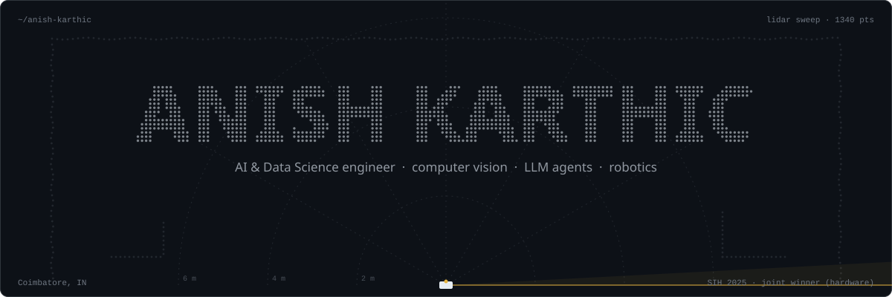

  <a href="https://www.linkedin.com/in/anish-karthic/">LinkedIn</a> &nbsp;·&nbsp;
  <a href="mailto:anishkarthicvs@gmail.com">anishkarthicvs@gmail.com</a> &nbsp;·&nbsp;
  Coimbatore, India

I'm Anish, a B.Tech student in **Artificial Intelligence & Data Science** at KGiSL Institute of Technology, Coimbatore. I build AI systems end to end: the model, the service around it, and the device or app it runs on. That means vision pipelines that verify an ID from a phone camera, multi-agent LLMs on a local model, and ROS 2 software that lets a small car be driven by a joystick, a planner or a prompt.

**Now:** taking [OpenDrive Stack](https://github.com/ANISHKARTHIC/OpendriveStack) from manual and autonomous driving towards LLM prompt driving, and building [Verdict](https://github.com/ANISHKARTHIC/trader), a research agent that runs entirely on a local model.

## Selected work

<a href="https://github.com/ANISHKARTHIC/OpendriveStack"></a>

<a href="https://github.com/ANISHKARTHIC/OpendriveStack">Source →</a>

<a href="https://github.com/ANISHKARTHIC/SHIELDID-SYSTEM"></a>

<a href="https://github.com/ANISHKARTHIC/SHIELDID-SYSTEM">Source →</a>

<a href="https://github.com/ANISHKARTHIC/trader"></a>

<a href="https://github.com/ANISHKARTHIC/trader">Source →</a>

<a href="https://github.com/ANISHKARTHIC/ENDLESS-DREAMS"></a>

<a href="https://endless-dreams-inno.vercel.app">Live demo</a> &nbsp;·&nbsp; <a href="https://github.com/ANISHKARTHIC/ENDLESS-DREAMS">Source →</a>

### More builds

<table>
  <tr>
    <td width="50%"><a href="https://github.com/ANISHKARTHIC/LMS"></a></td>
    <td width="50%"><a href="https://github.com/ANISHKARTHIC/CRES"></a></td>
  </tr>
  <tr>
    <td width="50%"><a href="https://github.com/ANISHKARTHIC/logGPT"></a></td>
    <td width="50%"><a href="https://github.com/ANISHKARTHIC/BOOTH"></a></td>
  </tr>
</table>

## Toolkit


## Recognition

<table>
  <tr>
    <td width="50%" valign="top">
      <b>Smart India Hackathon 2025</b> 
      Joint Winner, Hardware Edition · Team INNO-CORES 
      Cloudburst Early Warning and Alarm System (Ministry of Science &amp; Technology). I built the real-time sensor data layer and live dashboards. <a href="https://www.kgkite.ac.in/?p=18861">Announcement</a>
    </td>
    <td width="50%" valign="top">
      <b>Top Coders 2024</b> 
      Winner 
      Coding competition.
    </td>
  </tr>
</table>

<b>Team and open-source work</b>

 

| Where | What I did |
|---|---|
| [Mathi27/dropout-pred-pwa](https://github.com/Mathi27/dropout-pred-pwa) | DentalAI treatment-adherence platform: main developer (18 of 19 commits). Django, Celery, React PWA |
| [miles-spidee/simp](https://github.com/miles-spidee/simp) | College ERP: RBAC, super-admin and HR permissions, scoped data filters, Flutter app setup |
| [Mathi27/bits2bytes](https://github.com/Mathi27/bits2bytes) | Redesigned the STM32 lab track (10 labs) of an open embedded-systems learning site |
| [ARUNAWRISHE/Metadata-viewer](https://github.com/ARUNAWRISHE/Metadata-viewer) | Video-metadata inspector: v2 UI, Google Drive upload, deployment |
| [Mathi27/pdf-spool-optimizer](https://github.com/Mathi27/pdf-spool-optimizer) | Docker support and parallel page processing (merged) |

## Activity

  
  

## Contact

I'm open to internships and collaborations in applied AI: computer vision, LLM agents, robotics and the backend systems that ship them. The quickest way to reach me is [LinkedIn](https://www.linkedin.com/in/anish-karthic/) or **anishkarthicvs@gmail.com**.

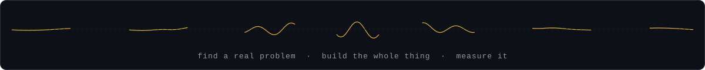
